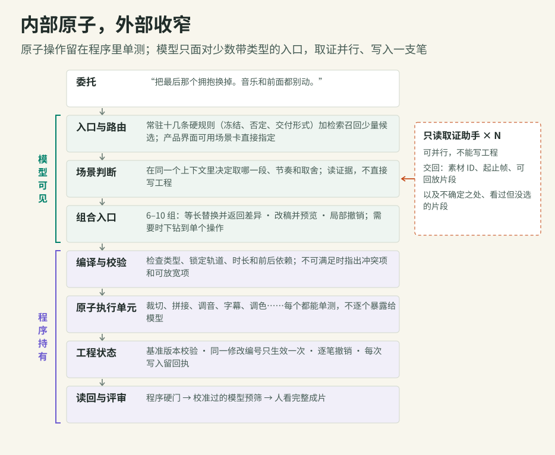

# Agent 架构笔记

面向产品经理、设计师和开发者的中文研究文章。研究 Agent 如何分工、Skill 如何组织，以及这些选择何时能改善用户拿到的结果。

## 首篇 · Agent 怎样分工，Skill 该拆多细？（第二版）

剪辑师收到一句改稿意见：“把最后那个拥抱换掉。想让人觉得他们认出了对方，音乐和前面都别动。”找对镜头、读懂表演、守住工程，是同一次交付里的三种能力。文章把“把 Skill 拆细”拆成三件事：拆知识、拆接口、拆执行，用技能评测、工具粒度实验、多代理公平对照和视频盲评逐一检验，再用一次 AI 短剧付费试拍和我们自己的剪辑技能库做对照。

**[阅读图解长文 ↗](https://dengxianghua888-ops.github.io/agent-architecture-notes/articles/agent-and-skill-orchestration/)** · [GitHub 正文](articles/agent-and-skill-orchestration.md) · [第一版 PDF 与 Word](https://github.com/dengxianghua888-ops/agent-architecture-notes/releases/tag/v1.0.0)

| 如果你在决定…… | 从这里读 |
| --- | --- |
| “拆细”到底在拆什么，三种拆分各自改变了什么？ | [“把 Skill 拆细”到底在拆什么](https://dengxianghua888-ops.github.io/agent-architecture-notes/articles/agent-and-skill-orchestration/#granularity) |
| 技能库越来越大，怎样知道方法有用、能被找到？ | [知识拆分：写进库里，不等于用得上](https://dengxianghua888-ops.github.io/agent-architecture-notes/articles/agent-and-skill-orchestration/#library) |
| 给模型多少个工具，要不要做组合入口？ | [接口拆分：让模型少走几步](https://dengxianghua888-ops.github.io/agent-architecture-notes/articles/agent-and-skill-orchestration/#interface) |
| 单个 Agent、固定流程、动态委派，该用哪一种？ | [执行拆分：谁看原片，谁拿笔](https://dengxianghua888-ops.github.io/agent-architecture-notes/articles/agent-and-skill-orchestration/#coordination) |
| 怎样让 Agent 改工程而不出事？ | [状态：写进工程的每一笔都要能对账](https://dengxianghua888-ops.github.io/agent-architecture-notes/articles/agent-and-skill-orchestration/#state) |
| 指标涨了，怎样知道用户真的拿到了更好的作品？ | [剪辑的难点](https://dengxianghua888-ops.github.io/agent-architecture-notes/articles/agent-and-skill-orchestration/#review) · [怎样证明编排改善了结果](https://dengxianghua888-ops.github.io/agent-architecture-notes/articles/agent-and-skill-orchestration/#evaluation) |
| 一次真实付费试拍说明了什么？ | [24 条 AI 短剧候选](https://dengxianghua888-ops.github.io/agent-architecture-notes/articles/agent-and-skill-orchestration/#case) · [自查清单](https://dengxianghua888-ops.github.io/agent-architecture-notes/articles/agent-and-skill-orchestration/#checklist) |

## 查证与复用

[证据附录](notes/evidence-review.md)记录了论文修订、产品能力的版本和入口、研究共用的样本、23 个视频主题的配对分差，以及第二版新增证据的来源分级。[待核清单](notes/research-todo.md)列出正文标 † 的数字和仍待补查的问题，并说明核对后怎样回填。正文中的改稿流程是设计推演；实测数字均指向各自的原始研究。资料核对至 2026 年 11 月 27 日。

可以在仓库根目录运行 `python3 scripts/check_paired_scores.py`，离线复算主题分差和重采样区间。引用文章时，请标明文章标题、项目名称和版本。提出勘误时，请附上涉及的段落、来源版本和能改变判断的证据。

撰写下一篇可从[分析文章模板](templates/article.md)开始。[阅读页排版与构建指南](templates/authoring.md)说明如何从同一份 Markdown 生成支持手机阅读与打印的页面，以及如何保留旧文章的固定地址。

## 许可

原创文章、图解和写作模板采用 [CC BY 4.0](LICENSE-CONTENT)，署名可写“Agent 架构笔记贡献者”并链接仓库。构建与分析脚本、网页模板、样式和交互代码采用 [MIT](LICENSE)。引用的论文、产品文档和第三方材料保留各自的许可。
